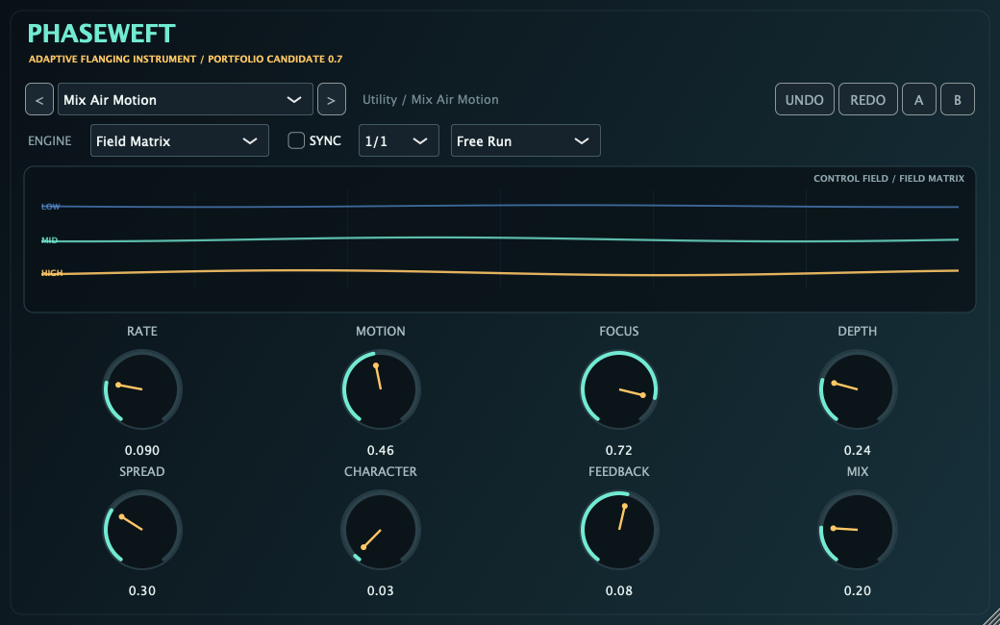

# Phaseweft

Phaseweft is a JUCE audio-effect project that explores content-aware flanging. Alongside conventional and through-zero flanging, it can separate transient and sustain motion or distribute related delay trajectories across three reconstructing frequency bands.

> **Project status:** private GitHub portfolio candidate, currently v0.7.0. G3 REAPER VST3/AU host verification and G4 documentation/demonstration are complete. G5 portfolio-release preparation is next.

Phaseweft is presented as an engineering and audio-DSP project, not as a commercially released product. The project name and provisional manufacturer metadata have not received formal trademark clearance. No signed or notarized installer is currently supplied.



## Highlights

- Four continuously warm, click-smoothed engines:
  - **Classic** — conventional positive-delay flanging.
  - **Through-Zero** — wet motion crosses a latency-aligned dry reference.
  - **Transient Split** — transient and sustain components follow different trajectories.
  - **Field Matrix** — three reconstructing bands respond to spectral balance and transient activity.
- Cubic fractional-delay interpolation, stereo cross-feedback and feedback-path colour.
- Host-tempo sync with 12 straight, dotted and triplet divisions.
- Free-running or restart-on-play modulation.
- 18 categorized factory presets.
- Resizable interface, trajectory visualization, A/B comparison and Undo/Redo.
- Stable parameter IDs, schema-versioned state migration and malformed-state rejection.
- Core, preset, long-run and plug-in-state tests.

## Current support status

| Target | Status |
|---|---|
| macOS Standalone | Clean-clone and CI builds pass |
| macOS VST3 | Clean-clone and CI builds pass; REAPER 7.67 G3 host workflow passed |
| macOS Audio Unit | Clean-clone and CI builds pass; REAPER 7.67 G3 and current Apple `auval` passed |
| Universal macOS `x86_64;arm64` | Current G2 clean-clone and CI build/test pass |
| Windows VST3/Standalone | Release build and 4/4 automated tests pass on `windows-2022` CI; DAW use is not yet verified |
| REAPER host workflow under Phaseweft identity | VST3/AU passed on macOS arm64; see `docs/G3_REPORT.md` |

Only rows explicitly marked as verified are support claims.

## Listen

The deterministic eight-second comparison set uses one procedural source, so the engine is the main variable:

| Reference | Classic | Through-Zero | Transient Split | Field Matrix |
|---|---|---|---|---|
| [Dry](artifacts/audio/00_dry.wav) | [Play](artifacts/audio/01_classic.wav) | [Play](artifacts/audio/02_through_zero.wav) | [Play](artifacts/audio/03_transient_split.wav) | [Play](artifacts/audio/04_field_matrix.wav) |

Six additional preset renders and reproduction details are indexed in [DEMO_AUDIO.md](docs/DEMO_AUDIO.md). The files are comparison evidence rather than loudness-matched marketing masters.

## Build from source

Requirements:

- CMake 3.22 or newer
- A C++20 compiler
- Git for cloning the Phaseweft repository
- Xcode command-line tools on macOS

The default configuration fetches the pinned JUCE 9.0.2 source archive and verifies its SHA-256 automatically:

```bash
cmake -S . -B build/release \
  -DCMAKE_BUILD_TYPE=Release \
  -DMOTION_FIELD_BUILD_PLUGIN=ON
cmake --build build/release --config Release --parallel
ctest --test-dir build/release --output-on-failure
```

To reuse an existing JUCE checkout without downloading it again:

```bash
cmake -S . -B build/release \
  -DMOTION_FIELD_BUILD_PLUGIN=ON \
  -DMOTION_FIELD_JUCE_DIR=/absolute/path/to/JUCE
```

An explicit invalid `MOTION_FIELD_JUCE_DIR` fails configuration rather than silently selecting another dependency.
The archive URL is exposed as `MOTION_FIELD_JUCE_URL` for offline mirrors, while the pinned SHA-256 remains mandatory.

Core DSP tests do not require JUCE:

```bash
cmake -S . -B build/core -DCMAKE_BUILD_TYPE=Release -DMOTION_FIELD_BUILD_PLUGIN=OFF
cmake --build build/core --parallel
ctest --test-dir build/core --output-on-failure
```

Reproducible presets are also available:

```bash
cmake --preset core-release
cmake --build --preset core-release --parallel
ctest --preset core-release
```

On macOS, use `macos-universal-release` for the universal build. It uses the same pinned fetch unless `MOTION_FIELD_JUCE_DIR` is provided.

For bundle locations, local installation and host discovery, see [INSTALLATION.md](docs/INSTALLATION.md) and [TROUBLESHOOTING.md](docs/TROUBLESHOOTING.md).

## Controls

| Control | Function |
|---|---|
| Engine | Classic, Through-Zero, Transient Split or Field Matrix |
| Preset | 18 categorized starting points |
| Sync / Division | Host BPM lock and rhythmic cycle length |
| Transport | Free Run or Restart on Play |
| Rate | Base motion rate, 0.02–5 Hz |
| Motion | Amount of content-dependent movement |
| Focus | Moves field emphasis between low and high frequencies |
| Depth | Delay excursion |
| Spread | Stereo phase separation and cross-feedback |
| Character | Nonlinear feedback colour |
| Feedback | Bipolar feedback, limited to ±0.88 |
| Mix | Latency-aligned dry/wet blend |

## Signal architecture

```text
Input ─┬─ 4 ms dry reference ─────────────────────────────────────────┐
       ├─ Classic voice ──────────────────────────────────────────────┤
       ├─ Through-Zero voice ─────────────────────────────────────────┤
       ├─ transient detector ─┬─ transient voice ─────────────────────┤
       │                      └─ sustain voice ───────────────────────┤
       └─ three-band split ───── adaptive field voices × 3 ───────────┤
                                                                    Mix ─ Output
```

Inactive engines remain warm. Engine changes crossfade between valid DSP states instead of starting with an empty delay line.

The detailed signal, timing, parameter and saved-state design is documented in [ARCHITECTURE.md](docs/ARCHITECTURE.md).

## State compatibility

The internal state root remains `MotionFieldState` for compatibility with earlier project files. Existing host parameter IDs are treated as immutable and are covered by an automated identity-contract test. A public-facing rename must not silently break saved sessions.

## Repository map

- `Source/DSP` — dependency-free DSP and factory presets.
- `Source/Plugin` — JUCE processor, editor and state migration.
- `tests` — unit, stress, preset, state, audio-render and UI-snapshot targets.
- `artifacts/audio` — reference and featured-preset demonstrations.
- `artifacts/screenshots` — reproducible interface evidence generated from the current editor source.
- `docs` — architecture, specifications, build guidance, audit record, QA evidence and roadmap.
- `release` — DAW matrix, known issues and validation summaries.
- `.github/workflows` — macOS and Windows build/test workflow.
- `THIRD_PARTY_NOTICES.md` — JUCE version, acquisition and licence boundary.
- `docs/ASSET_PROVENANCE.md` — reproducible provenance for retained audio and visual assets.

## Evidence and limitations

The automated suite covers multi-rate processing, mode changes, latency, parameter stress, preset safety, state migration and malformed input. Current G3 evidence covers REAPER VST3/AU discovery, playback, automation, bypass, freeze, recall, host PDC and rendering; current Apple `auval` also passes. See [G3_REPORT.md](docs/G3_REPORT.md), [QA_REPORT.md](docs/QA_REPORT.md) and the historical [V060_SUMMARY.md](release/validation/V060_SUMMARY.md).

The current limitations are tracked in [KNOWN_ISSUES.md](release/KNOWN_ISSUES.md). The path to a completed GitHub portfolio release is defined in [ROADMAP.md](docs/ROADMAP.md).

## Licence

Phaseweft is currently private, all-rights-reserved source code. Repository access does not grant permission to copy, redistribute, publish or create derivative works beyond uses explicitly authorized by the owner. See [LICENSE](LICENSE).

JUCE 9.0.2 remains subject to its own AGPL-3.0-only or commercial JUCE licence options; see [THIRD_PARTY_NOTICES.md](THIRD_PARTY_NOTICES.md). The Phaseweft licence may be changed manually by the owner before a future public release.

## Project completion definition

Phaseweft is complete for this roadmap when a clean clone can obtain its dependencies, build the documented targets, pass automated tests, pass the recorded REAPER VST3/AU workflow, and provide accurate documentation plus a verifiable GitHub release. Commercial trademark clearance, paid distribution, code signing, notarization and installers are explicitly outside this completion definition.
