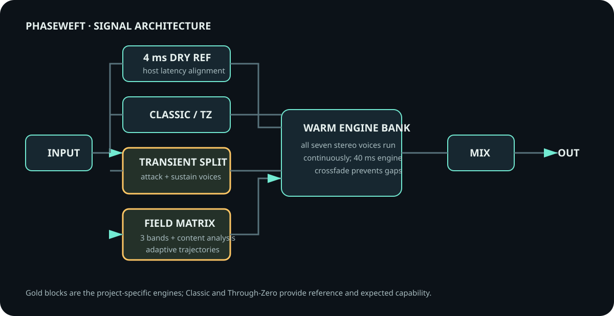

# DSP and state architecture

Phaseweft is split into a dependency-free DSP layer and a JUCE plug-in layer. The separation keeps the signal algorithms independently testable while JUCE supplies host formats, parameters, editor integration and binary state transport.

## Signal path

Every engine uses a four-millisecond latency reference. Classic stays on the positive-delay side of that reference. Through-Zero moves the wet path around it. Transient Split derives a continuous attack mask and sends attack and sustain energy through different delay trajectories. Field Matrix reconstructs low, mid and high bands by subtraction, measures their smoothed energy, and perturbs three related trajectories from spectral position and transient activity.

All engine voices remain warm. A 40 ms crossfade changes engine output without starting from an empty delay line. Delay taps use cubic interpolation. Parameter targets are smoothed, feedback is limited before smoothing, and the feedback colour has unity gain around zero. An emergency output guard handles non-finite or extreme state but stays inactive in the normal range.

The processor reports four milliseconds of latency to the host. The Mix control combines the wet output with the latency-aligned dry reference, so changing Mix does not move the dry signal relative to the processed path.

## Timing

Manual Rate covers 0.02–5 Hz. Sync derives the cycle rate from host BPM and one of 12 straight, dotted or triplet divisions. Free Run preserves modulation phase across transport stops. Restart on Play resets modulation phases on the stopped-to-playing transition while preserving delay and feedback histories.

## Parameters and presets

The public parameter identifiers are an immutable compatibility contract:

`mode`, `rate`, `motion`, `focus`, `depth`, `spread`, `character`, `feedback`, `mix`, `sync`, `division`, `transport`

The 18 factory presets contain only those public values. Loading a preset uses host-notified parameter changes and is therefore visible to automation and Undo. After host recall or an internal state operation, Phaseweft identifies a factory preset only if the complete parameter state matches it; otherwise the editor displays `Custom state`.

## Saved state compatibility

The binary state root remains `MotionFieldState`, even though the public product name is Phaseweft. Renaming this internal root would break earlier sessions for no audible benefit. State data carries a schema version and migration fills parameters absent from older documents with canonical defaults. Foreign or malformed state is rejected. Automated tests cover the permanent parameter-ID set, legacy migration, current round-trips, exact preset identity and custom-state fallback.

The secondary A/B slot is intentionally session-local in v0.7. The active processing state is saved by the host; the alternate comparison slot is not promised as portable project state.

## Source map

- `Source/DSP` contains delay lines, engine processing, timing helpers and factory presets without a JUCE dependency.
- `Source/Plugin` contains the JUCE processor, state migration, editor, accessibility descriptions and visualization.
- `tests` contains core correctness, long-run stress, preset audit, plug-in-state and deterministic demo-render targets.

For measured validation boundaries, see [G3_REPORT.md](G3_REPORT.md) and [QA_REPORT.md](QA_REPORT.md).
